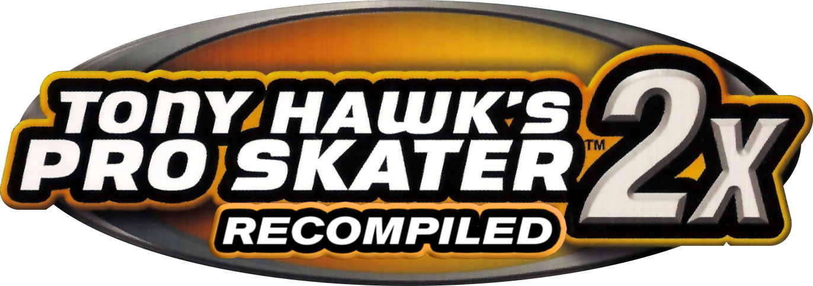

<p align="center">
  
</p>

# THPS 2X Recompiled

A static recompilation of *Tony Hawk's Pro Skater 2X* (Xbox, USA) into native PC code, with a Vulkan renderer and a
set of modern extras: higher resolutions, widescreen, 120 fps, custom soundtracks, RetroArch shader support, button
remapping and a full settings menu inside the game.

> This project contains **no game data, no game code and no keys**. You need your own copy of the game (USA disc).

> **AI disclosure:**  AI assistance yes (Claude Code by Anthropic).

---

## Features

### Native port, no emulator
- The original Xbox code is translated to C ahead of time and compiled for the PC – no CPU emulation at run time.
- **Vulkan 1.3** renderer on every platform, **SDL3** for window, input and audio, plain **C** code.
- Game logic runs on its own clock: the game never speeds up, whatever the frame rate.

### Rearranged options menu
Everything is set inside the game's own **Options** menu – no external tool, no overlay. New entries:

| Entry | What it does |
|---|---|
| **CONTROLS** | Per player: pick the input device, then remap its buttons (**BUTTON MAPPING**). Unconnected pads are greyed out. |
| **SOUNDTRACKS** | Pick the music source and one of 8 playback modes (see *Custom soundtracks*). |
| **RECOMP OPTIONS** | All port settings (see below). |

### RECOMP OPTIONS
Changes are saved immediately. Settings that need a restart are marked, and leaving the menu asks **RESTART NEEDED**.

| Setting | Values |
|---|---|
| **Display mode** | Borderless (default), Fullscreen (exclusive), Windowed – window size and position are remembered |
| **Render resolution** | 1x (original 640×480) up to 5x (e.g. 1080p, 1440p, 4K) – independent of the window size |
| **Aspect ratio** | 4:3 (original) or 16:9 – real widescreen (wider view), not stretched |
| **Menus at 16:9** | Pillarboxed (default) or stretched – only shown with 16:9; movies always stay 4:3 |
| **Anisotropic filter** | Off up to 16x |
| **Antialiasing** | Off, FXAA (default), SMAA, MSAA 2x, MSAA 4x |
| **Frame rate** | Original (60 fps) or 120 fps (needs a display with 120 Hz or more), V-Sync, FPS counter (FPS, frame time or both) |
| **Shaders** | RetroArch slang shaders with preset browser, live parameters and your own presets |
| **Boot animation** | Plays your own intro video before the game for example a video of original xbox boot animation ;) |

### Widescreen (16:9)
- Gameplay is rendered in true 16:9 (Hor+): you see more to the sides, nothing is stretched or cut.
- Menus, loading screens and movies stay 4:3 with black side bars (or optionally stretched for menus).
- Split screen is handled as well.

### 120 fps
- Optional, on displays with at least 120 Hz. On slower displays the game stays at 60 fps.
- Gravity, speed, the session timer and replays behave exactly like at 60 fps.

### Custom soundtracks
Put your own music into the `media` folder and choose it in **Options → SOUNDTRACKS**:
- **SOUNDTRACK:** game music, **COMBINED** (game music + your albums) or a single album of yours.
- **PLAYBACK MODE:** play songs in order (the game's music, original behaviour) · play album in order · shuffle game
  music · shuffle album · shuffle all custom albums · shuffle all · play all in order · play all custom albums in
  order.
- Your choice is remembered (the original game forgets it at every start). The in-game picker in the pause menu
  keeps working.

### RetroArch shader support
- CRT, LCD/handheld, scaling and many more effects from the official
  [libretro slang-shaders](https://github.com/libretro/slang-shaders) pack.
- Browse presets by folder (the pass count is shown as a cost hint), change parameters live, reset them, and save
  your own presets.
- The shader only affects the game picture, never the black side bars. Off = no cost at all.

### Button remapping
- Keyboard and every gamepad (Xbox, PlayStation, Switch, generic) can be remapped per device; identical pads share
  one mapping.
- The menus always stay usable with the default layout, so a bad mapping can never lock you out.

### Everything in one folder
- The port runs from one folder that can be moved or copied anywhere – even to a USB stick.
- **Nothing is written outside it:** no registry, no AppData, no shortcuts, no temp files left behind.

### Installer built in
- Put your disc image into `game\` (or pick it with **Choose disc image...**) and start the game: it checks,
  extracts and verifies the image itself. An image in `game\` is deleted afterwards; an image picked elsewhere stays
  where it is.
- A wrong game or an unsupported version is refused with a clear message, and the image is kept.

---

## Getting started

### Requirements
- Windows 10/11, 64-bit
- A GPU with **Vulkan 1.3**
- Your own copy of *Tony Hawk's Pro Skater 2X* (USA)
- About **2 GB** of free disk space (no internet needed: the compiler ships inside the release zip)

### Supported version

| Version | Title ID | `default.xbe` SHA-1 |
|---|---|---|
| USA (NTSC-U) | 41560001 | `469818E015AED2730641C0BDCBD2557D8A6B8BB4` |

Other versions are refused with: *"This THPS 2X version is not supported. Supported version(s): USA. Please provide
a supported version."*

### First start
1. Download the release zip from the release page and unpack it into an empty folder of your choice (keep the
   `tools\` folder next to the exe).
2. Start `THPS 2X Recomp.exe`. It creates the folders below (each with a short `README.txt`) and asks for the game:
   put your disc image (`.iso`, XISO or full redump image) **or** the extracted disc files into `game\`, or click
   **Choose disc image...**.
3. The first start then sets everything up, with a progress window:
   - the image is checked, extracted and verified,
   - the compiler ([llvm-mingw](https://github.com/mstorsjo/llvm-mingw), a fixed release, in the zip's
     `tools\download\`) is checked by its SHA-256 and unpacked – only if that file is missing is it downloaded
     (about 190 MB); if the download fails you get the real reason (name lookup, connection, secure connection or
     the server's answer) with **Retry**, and the link to download it by hand,
   - the game's code is translated and compiled on your PC (a few minutes, only once).
4. The game starts. Later starts go straight into the game.
5. Optional: add your music, shader pack and boot video (see next section).

> **Windows warning:** the exe is not signed. **SmartScreen** shows "Windows protected your PC" – click
> **More info → Run anyway**. **Smart App Control** (Windows 11) blocks unsigned apps completely; the port can only
> run with Smart App Control turned off.

---

## Where your files go

```
THPS 2X Recomp/
├── THPS 2X Recomp.exe      start this (sets everything up on the first start, then starts the game)
├── THPS2X.exe              the port – built on your PC on the first start
├── game/                   YOUR GAME: put the disc image or extracted files here
├── media/                  YOUR MEDIA (read only – the port never changes it)
│   ├── boot.mpg            optional boot animation
│   ├── shaders/
│   │   └── shaders_slang.zip   optional RetroArch shader pack
│   ├── Punk/               every folder with music = one soundtrack
│   └── Artist/Album/       folders can be nested
├── saves/                  your saves and settings – never deleted
│   ├── UDATA/41560001/     career, skater and park saves
│   ├── settings.ini        all port settings
│   └── shaders/            your own shader presets ("My Presets")
├── data/                   caches and logs – safe to delete at any time
└── tools/                  translator, compiler and licences (used on the first start and for a repair)
```

### Game → `game\`
- One disc image (`.iso`) or the extracted disc folder. `default.xbe` must sit directly in `game\`.
- The image is deleted only after every extracted file has been verified. On any error it stays.

### Music → `media\`
- **Every folder that contains music files is one soundtrack**, named after the folder. Folders can be nested
  (`Artist\Album\`); music lying directly in `media\` is ignored.
- Formats: **MP3, FLAC, Ogg Vorbis, WAV**. (`.m4a`/AAC is not supported – convert it to MP3 or Ogg.)
- Track order: an `.m3u`/`.m3u8` playlist in the folder sets it; otherwise the files are sorted by name.
- Up to 500 tracks per soundtrack. Two folders with the same name get their parent folder in front.

### Shaders → `media\shaders\`
1. Download the shader pack from [libretro/slang-shaders](https://github.com/libretro/slang-shaders)
   (green **Code** button → **Download ZIP**) and save it as `media\shaders\shaders_slang.zip`.
   An already extracted folder works too.
2. Start the game. The pack is unpacked once in the background into `data\shaders` (a few seconds).
3. **Options → RECOMP OPTIONS → SHADERS:** switch the shader on, pick a preset, adjust parameters, save your own
   preset.
- Good first presets: `crt\crt-easymode`, `crt\crt-guest-advanced`, `handheld\…` (LCD/Game Boy looks).
- Presets that draw a frame (bezel/border) are hidden, because the shader only covers the game picture.

### Boot animation → `media\boot.mpg`
- Your own intro video, played before the game starts. It cannot be skipped – keep it short. It can be switched
  off in RECOMP OPTIONS (the change applies at the next start).
- Format: MPEG-1 video with MP2 audio. Convert any video once with the free [ffmpeg](https://ffmpeg.org) –
  720p at 30 fps is recommended (light to decode, small file):
  ```
  ffmpeg -i boot.mp4 -vf scale=-2:720 -r 30 -c:v mpeg1video -q:v 2 -c:a mp2 -b:a 192k boot.mpg
  ```
  Full resolution also works (leave out `-vf scale=-2:720 -r 30`), but costs more CPU while it plays.
- A `boot.mp4` or `boot.mkv` alone is not played; BOOT ANIMATION then says "CONVERT BOOT VIDEO TO BOOT.MPG  SEE
  README". The port never converts or changes your files.
- Never shipped with the port – you supply your own video.

---

## Controls

Gamepads work out of the box via SDL3 (incl. rumble). Keyboard default (physical key positions):

| Key | Xbox pad |
|---|---|
| W A S D | left stick |
| Arrow keys | D-pad |
| Enter / Backspace | Start / Back |
| I / J / K / L | Y / X / A / B |
| U / O | Black / White |
| Z / P | left / right trigger |

Remap in **Options → CONTROLS → PLAYER n CONTROLS → BUTTON MAPPING**.
**Emergency exit:** if a mapping leaves you stuck, start once with the environment variable `THPS_BIND_RESET=1`, or
delete the `bind.` lines from `saves\settings.ini`.

---

## Advanced

- **Settings file:** `saves\settings.ini` (plain `key=value`), shared by the menus.
- **Overrides:** every setting can be forced with an environment variable `THPS_<SETTING>` (e.g.
  `THPS_DISPLAY_MODE=windowed`).
- **Logs:** `data\thps2x.log` (the previous run is kept as `.previous.log`); the first-start setup logs to
  `data\launcher.log`.
- **Repair:** `"THPS 2X Recomp.exe" --repair` unpacks, translates and compiles everything again; `saves\` and
  `media\` are never touched.

---

## Portability

- Written in portable C with SDL3 and Vulkan only; platform code is kept in one thin layer.
- Linux and Android are planned but **paused** for now. The code is kept ready for them.

### Linux via Proton / Wine: best effort
The Windows build runs under Proton and Wine too (from v0.9.1.1: the first start uses no Windows system tools any
more, and the crash at the title screen is fixed). **Tested on Arch Linux with Proton 11.0-2 and Wine 11.20:**
install, first start and the game work. It is not tested as thoroughly as Windows. Known limits:
- Needs a Wine / Proton with Vulkan (winevulkan) and the host's Vulkan driver, 64-bit.
- Only a compiler download (when `tools\download\` is missing) needs the host's CA certificates (package
  `ca-certificates`) and 64-bit GnuTLS – a missing certificate store shows up as a *secure connection* error.
- The first start (translate + compile) is slower than on Windows.
- *Open folder* and the file picker depend on your Wine desktop integration.
- Controllers go through Wine's input layer; report what does not work.
- Native Linux builds are still paused.

---

## Known issues

- **Frame pacing** is smooth with the default present mode MAILBOX. Drivers without MAILBOX fall back to FIFO,
  where occasional ~33 ms frames occur.
- The first frame after a level has loaded can take 40–120 ms (shaders and textures are prepared; faster once
  cached).
- Split screen with two physical controllers is not fully tested yet.
- The exe is not signed (see *Windows warning* above).

---

## Roadmap

- **First release:** the game with all extras listed above.
- **maybe Later:** Linux and Android.

### Non-goals
- Online play.

---

## Building from source

The release exe is built from this repository and the toolkit
[xboxrecomp-vulkan](https://github.com/almost-drowned-rat/xboxrecomp-vulkan) (branch `vulkan-backend` state). Both
folders side by side in one parent folder, the toolkit folder named `xboxrecomp`; Windows 10/11 x64.

1. `powershell -ExecutionPolicy Bypass -File tools\setup.ps1` – installs Python 3.12, CMake, Ninja, LLVM-MinGW (UCRT)
   and the Vulkan SDK with winget, `capstone` for Python, and a short-path junction to the parent folder (default
   `C:\rc`) for paths with spaces.
2. `tools\deps.ps1` – builds glslang, SDL3 and librashader from source with the same compiler.
3. `tools\lift.ps1 -Iso "<path to your USA .iso>"` – extracts the disc into the install folder and generates the C
   code (into a `private\` folder next to the repo, never into it).
4. `tools\build.ps1` – builds into the portable install folder `THPS 2X Recomp\`.
5. Optional: `tools\release.ps1 -Version <name>` – the single release exe (the launcher with its payload).

---

## Legal

This repository and its releases contain no game data, no XBE, no generated game code and no keys. You need your
own legally obtained copy of the USA disc.

This project is not affiliated with or endorsed by Activision, Neversoft or Treyarch. *Tony Hawk's Pro Skater* and
all related names and trademarks belong to their respective owners.

---

## Credits & third-party code

| Project | Used for | Licence |
|---|---|---|
| [sp00nznet/xboxrecomp](https://github.com/sp00nznet/xboxrecomp) | toolkit base: XBE lifter, kernel/runtime, game template | MIT |
| [antoxa2584x/burnout3-sw](https://github.com/antoxa2584x/burnout3-sw) | Vulkan NV2A renderer, back-end interface, pushbuffer executor | MIT |
| [xemu-project/xemu](https://github.com/xemu-project/xemu) | MCPX APU core, ADPCM decoder, NV2A definitions, fixed-function vertex shader | LGPL-2.1-or-later (these files) |
| [comoria08/defjam_recomp](https://github.com/comoria08/defjam_recomp) | lift pipeline and seeds workflow | MIT |
| takedawn-xboxrecomp | XDVDFS disc reader | MIT |
| [librashader](https://github.com/SnowflakePowered/librashader) | RetroArch shader runtime (self-built, Vulkan only) | MPL-2.0 |
| [iryoku/smaa](https://github.com/iryoku/smaa) | SMAA antialiasing | MIT |
| [miniz](https://github.com/richgel999/miniz) (tinfl) | unpacking the shader pack | MIT |
| [dr_libs](https://github.com/mackron/dr_libs), [stb_vorbis](https://github.com/nothings/stb) | MP3, FLAC, WAV, Ogg decoding | Public domain / MIT |
| [phoboslab/pl_mpeg](https://github.com/phoboslab/pl_mpeg) | boot animation (MPEG-1 video, MP2 audio) | MIT |
| [SDL3](https://github.com/libsdl-org/SDL), [glslang](https://github.com/KhronosGroup/glslang) | window, input, audio; shader compiler | zlib; BSD/MIT |
| [Python](https://www.python.org) 3.12 (embeddable), [capstone](https://github.com/capstone-engine/capstone) | the translator on the first start (shipped in `tools\`) | PSF; BSD |
| [mstorsjo/llvm-mingw](https://github.com/mstorsjo/llvm-mingw) | the compiler (downloaded on the first start) and its runtime | Apache-2.0 with LLVM exception; MinGW-w64 runtime licences |

Logo/banner artwork: [@GectorNathan](https://github.com/GectorNathan).

Design references (no code taken): Cxbx-Reloaded, XboxXBE-Recomp, SCDA-XBERecomp, doa3-recomp, doaxvb-re,
ARMSX2 (shader menu logic), black-pc, CoD3Recomp, pinyon-shift, xboxdevwiki.

Full licence texts and attributions: the toolkit's `NOTICE` and `LICENSES/`, and in the release `tools\licenses\`.

## Licence

GPL-3.0-or-later – see [LICENSE](LICENSE). Third-party code keeps its own licence.
