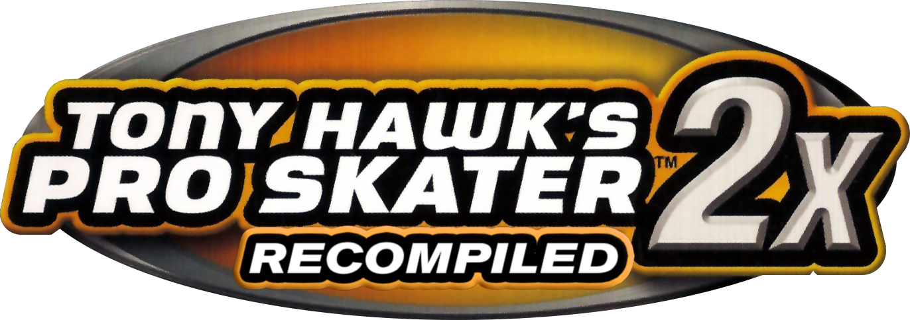

<p align="center">
  
</p>

# THPS 2X Recompiled

A static recompilation of *Tony Hawk's Pro Skater 2X* (Xbox, USA) into native PC code, with a Vulkan renderer and a
set of modern extras: higher resolutions, widescreen, 120 fps, custom soundtracks, RetroArch shader support, button
remapping and a full settings menu inside the game.

> This project contains **no game data, no game code and no keys**. You need your own copy of the game (USA disc).

> **AI disclosure:**  AI assistance yes (Claude Code by Anthropic).

---

## Highlights: play it like the originals

- **Classic career** – THPS 1 levels first, then THPS 2, then 2X, each part with its own rules (see *Classic
  career*).
- **SCORE CALCULATION: THPS 1** – trick values, combo multiplier and repeat penalty as in THPS 1. Always on in the
  classic career's THPS 1 levels, and a switch for everywhere else (new in v1.1.0).
- **PHYSICS: ORIGINAL THPS 2 PS1** – the gravity and ollie of THPS 2 on the PlayStation: shorter, snappier jumps
  instead of 2X's floatier ones (new in v1.1.0).

All three are in **Options → GENERAL OPTIONS** (CAREER MODE, and GAMEPLAY for the two switches).

---

## Features

### Native port, no emulator
- The original Xbox code is translated to C ahead of time and compiled for the PC – no CPU emulation at run time.
- **Vulkan 1.3** renderer on every platform, **SDL3** for window, input and audio, plain **C** code.
- Game logic runs on its own clock: the game never speeds up, whatever the frame rate.

### Rearranged options menu
Everything is set inside the game's own **Options** menu – no external tool, no overlay. New entries:

| Entry | What it does |
|---|---|
| **CONTROLS → RECOMP CONTROL OPTIONS** | Per player (PLAYER 1-4): **BUTTON MAPPING** (pick the input device, then remap its buttons) and the free camera settings (see *Free camera*). |
| **GENERAL OPTIONS** | Career mode, soundtracks, the game's own four options and the gameplay options (see below). |
| **RECOMP OPTIONS** | All port settings (see below). |
| **QUIT GAME** | Closes the game after a question (it opens on NO). The pause menu in a level has QUIT GAME too. |

### GENERAL OPTIONS
One list, changed with left / right or A and saved at once. **Y puts the selected line back to its default** -
only that line.

| Setting | Values |
|---|---|
| **Career mode** | ORIGINAL or CLASSIC, for new careers (see *Classic career*). A career keeps the mode it started with. |
| **Soundtracks ▸** | The music source and the playback mode (see *Custom soundtracks*). |
| **Trick tips, Score display, Quick chat** | The game's own options, ON (default) or OFF. (Motion blur moved to RECOMP OPTIONS.) |
| **Playstyle** | XBOX (original) or PS2: spins on Black / White (on a modern pad the shoulder buttons LB / RB), nollie and switch stay on the triggers. Works on top of your button mapping - if Black / White are not mapped to anything, PS2 has no spins. |
| **Gameplay ▸** | The gameplay options below, in their own list (Y works there too). |

**GAMEPLAY:**

| Setting | Values |
|---|---|
| **180 spin taps** | ON (original) or OFF: tapping a trigger in the air no longer turns 180°; holding it still spins. |
| **Big drop** | ORIGINAL: a drop from a moderate height scores BIG DROP, from a very great height you bail. NO BAIL: no bail, the drop counts as BIG DROP. OFF: neither - every drop lands like a normal one. |
| **Wall bail** | ORIGINAL or NO BAIL: holding grind into a wall at an angle too steep for a wallride (60° or more) no longer bails - the skater meets the wall as without grind. Wallrides themselves work as before. |
| **Manuals** | ON (original) or OFF: no manuals or nose manuals, as in THPS 1. |
| **Physics** | 2X (original) or ORIGINAL THPS 2 PS1: the gravity and flat-ground ollie of THPS 2 on the PlayStation. 2X lowered the gravity by about 8 % and made the ollie about 12 % stronger; with ORIGINAL THPS 2 PS1 a flat ollie is about 20 % shorter in the air, as on the PS1. Applies at once. |
| **Score calculation** | THPS 2 (original) or THPS 1: tricks score their THPS 1 values, the multiplier counts the tricks of the combo plus the last air's spin (as in THPS 1), no switch bonus, no perfect / sloppy landing factor, the repeat penalty 100 / 75 / 50 / 25 / 10 %. Tricks THPS 1 did not have get a value scaled from similar tricks - in doubt the lower one. A grab tapped instead of held counts half. **Always THPS 1 in the classic career's THPS 1 levels.** |

### Classic career
A new career with **CAREER MODE: CLASSIC** plays the parts in release order, each with its own rules:
- **THPS 1 levels first**, opened by tapes as in THPS 1. This part pays no cash on purpose: its goals are easier than
  the THPS 2X career's, so as a small challenge the skater cannot be pushed with stat points until the THPS 2 part.
  **These levels always score as in THPS 1 and have no manuals** (THPS 1 had none), whatever SCORE CALCULATION and
  MANUALS say.
- **A Roswell medal opens the THPS 2 levels**; their cash thresholds count from $0, and cash and the shop work as usual.
- **A Bullring medal opens the 2X levels.** Secret levels and rewards follow the original rules, with the THPS 1 part
  in the role THPS 2 has in the original.
- **Free Skate and Single Session** list the levels in the same order and open a part's levels only when the career
  has opened that part. Cheat codes work as usual.

### Free camera
Per player in **CONTROLS → RECOMP CONTROL OPTIONS → PLAYER n**: **FREE CAMERA** ON lets the right stick turn the
camera around the skater and up / down in every situation; it stays where you turned it. **INVERT CAMERA** (OFF, X,
Y, X AND Y), **CAMERA SENSITIVITY X / Y** (0-10, 0 locks that axis) and **CAMERA RESET SPEED** (0 slow to 9 fast,
10 jumps back at once). **CAMERA RESET** (the right stick click by default, remappable in BUTTON MAPPING) brings the
camera back behind the skater.

### RECOMP OPTIONS
Changes are saved immediately. Settings that need a restart are marked, and leaving the menu asks **RESTART NEEDED**.

| Setting | Values |
|---|---|
| **Display mode** | Borderless (default), Fullscreen (exclusive), Windowed – window size and position are remembered |
| **Render resolution** | From the original 640X480 up to about 5 times the lines (e.g. 1920X1080, 2560X1440, 3840X2160) – the sizes of the chosen aspect ratio, independent of the window size |
| **Aspect ratio** | 4:3 (original), 16:9, 16:10 or 21:9 – real widescreen (wider view), not stretched; after a restart |
| **Field of view** | ORIGINAL or +5 up to +30 degrees on the game's own camera – at once, every aspect ratio and split screen |
| **Menus at 16:9 / 16:10 / 21:9** | Pillarboxed (default) or stretched – only shown with a wide aspect ratio; movies always stay 4:3 |
| **Anisotropic filter** | Off up to 16x |
| **Antialiasing** | Off, FXAA (default), SMAA, MSAA 2x, MSAA 4x |
| **Motion blur** | The game's own effect while skating fast, ON (default) or OFF |
| **Frame rate** | Original (60 fps) or 120 fps (needs a display with 120 Hz or more, or V-Sync OFF), Frame pacing, V-Sync, FPS counter (FPS, frame time or both) |
| **Frame pacing** | DISPLAY (default) or 60 HZ TIMER: on a 120 / 180 / 240 Hz display the game's 60 Hz clock follows the display's own refresh, so every frame stays on screen equally long (no judder). Other displays (60, 144, 165 Hz, VRR) keep the timer either way. Applies after a restart. |
| **Shaders** | RetroArch slang shaders with preset browser, live parameters and your own presets |
| **Button cheats** | The game's button cheats as a list of 30 - no typing codes with LT held. Each line says what the cheat does and its code, and shows ON / OFF; A switches it, any combination works, Y switches the selected one off. One-time ones (unlock everything, 5000 cash, all gaps) say DO IT / DONE and cannot be undone. Only in the main menu's Options. |
| **Boot animation** | Plays your own intro video before the game for example a video of original xbox boot animation ;) |

### Widescreen (16:9, 16:10, 21:9)
- Gameplay is rendered in the chosen aspect ratio (Hor+): you see more to the sides, nothing is stretched or cut.
  21:9 matches 2560x1080 screens exactly; on 3440x1440 tiny bars remain.
- The gameplay HUD keeps its original proportions: SCORE and the SPECIAL bar at the left edge, SWITCH at the right.
- Menus, loading screens and movies stay 4:3 with black side bars (or optionally stretched for menus).
- Split screen is handled as well.

### Small comforts
- The mouse cursor hides itself over the game window and reappears when you move the mouse.
- The name entry after a high score starts with the initials you entered last time.

### 120 fps
- Optional, on displays with at least 120 Hz. On slower displays the game stays at 60 fps - unless V-Sync is OFF:
  then 120 fps runs on any display (for example a 60 Hz monitor: smaller tears and slightly fresher input, at
  twice the GPU work). V-Sync changes apply after a restart.
- Gravity, speed, the session timer and replays behave exactly like at 60 fps.

### Custom soundtracks
Put your own music into the `media` folder and choose it in **Options → GENERAL OPTIONS → SOUNDTRACKS**:
- **SOUNDTRACK** (left / right): game music, **ALL CUSTOM SOUNDTRACKS** (all your albums), **COMBINED** (game music +
  your albums) or a single album of yours.
- **PLAYBACK MODE:** **PLAY IN ORDER** - one song after the other; a new level or a retry goes on with the next song
  instead of starting over - or **SHUFFLE**.
- Your choice is remembered (the original game forgets it at every start). The in-game picker in the pause menu
  keeps working.

### RetroArch shader support
- CRT, LCD/handheld, scaling and many more effects from the official
  [libretro slang-shaders](https://github.com/libretro/slang-shaders) pack.
- Browse presets by folder (the pass count is shown as a cost hint), change parameters live, reset them, and save
  your own presets.
- The shader only affects the game picture, never the black side bars. Off = no cost at all.

### Button remapping
- Keyboard and every gamepad (Xbox, PlayStation, Switch, generic) can be remapped per device; identical pads share
  one mapping.
- The menus always stay usable with the default layout, so a bad mapping can never lock you out.

### Everything in one folder
- The port runs from one folder that can be moved or copied anywhere – even to a USB stick.
- **Nothing is written outside it:** no registry, no AppData, no shortcuts, no temp files left behind.

### Installer built in
- A small setup window asks for your disc image and the folder to install into, then **Go**: it checks, extracts
  and verifies the image, builds the game on your PC and shows the progress until **Play**. Your disc image is only
  read, never changed or deleted.
- A wrong game or an unsupported version is refused with a clear message, and the image is kept.
- No Vulkan 1.3 graphics card: the setup and the game say so in a message instead of crashing.

---

## Getting started

### Requirements
- Windows 10/11, 64-bit, or Linux with Proton / Wine (best effort, see *Linux via Proton / Wine*)
- **A graphics card with at least Vulkan 1.3 is required** (its driver must offer Vulkan 1.3 with dynamic rendering
  and `VK_KHR_push_descriptor`: NVIDIA GTX 900 and newer, AMD RX 400 and newer, Intel HD 500 / UHD 600 and newer,
  Intel Arc, Steam Deck). I am sorry, but older devices with only Vulkan 1.1 / 1.2 are not supported. On a PC
  without such a device, `THPS 2X Recomp.exe` and `THPS2X.exe` show a message saying so and naming the graphics
  devices found - a driver update often adds Vulkan 1.3.
- Your own copy of *Tony Hawk's Pro Skater 2X* (USA)
- About **2 GB** of free disk space (no internet needed: the compiler ships inside the release zip)

### Supported version

| Version | Title ID | `default.xbe` SHA-1 |
|---|---|---|
| USA (NTSC-U) | 41560001 | `469818E015AED2730641C0BDCBD2557D8A6B8BB4` |

Other versions are refused with: *"This THPS 2X version is not supported. Supported version(s): USA. Please provide
a supported version."*

### First start
1. Download `THPS2X-Recompiled-v<version>-win64.zip` (about 210 MB, the compiler included) from the release page
   and unpack it (keep the `tools\` folder next to the exe).
2. Start `THPS 2X Recomp.exe`. The setup window asks for two things: your disc image (`.iso`, XISO or full redump
   image) and the folder to install into (a new folder next to the exe is suggested; spaces in the path are fine).
   Press **Go**.
3. The setup copies itself and the compiler into that folder and sets everything up there, with the progress in the
   same window:
   - the image is checked, extracted and verified (the image itself is only read),
   - the compiler ([llvm-mingw](https://github.com/mstorsjo/llvm-mingw), a fixed release, in the zip's
     `tools\download\`) is checked by its SHA-256 and unpacked – only if that file is missing is it downloaded
     (about 190 MB); if the download fails you get the real reason (name lookup, connection, secure connection or
     the server's answer) with **Retry**, and the link to download it by hand,
   - the game's code is translated and compiled on your PC (a few minutes, only once).
4. Press **Play**. Later, start `THPS 2X Recomp.exe` in the install folder – it goes straight into the game.
5. Optional: add your music, shader pack and boot video (see next section).

Putting the disc image or the extracted disc files into `game\` by hand and starting `THPS 2X Recomp.exe` there
still works as before (an image in `game\` is deleted after a verified install).

### Updating from an earlier version
Unpack the new zip over the old install folder (the one with `THPS 2X Recomp.exe`, `game\` and `saves\`). The game
is built once more at the next start (a few minutes); your `saves\` and `media\` stay.

> **Windows warning:** the exe is not signed. **SmartScreen** shows "Windows protected your PC" – click
> **More info → Run anyway**. **Smart App Control** (Windows 11) blocks unsigned apps completely; the port can only
> run with Smart App Control turned off.

---

## Where your files go

```
THPS 2X Recomp/
├── THPS 2X Recomp.exe      start this (sets everything up on the first start, then starts the game)
├── THPS2X.exe              the port – built on your PC on the first start
├── game/                   YOUR GAME: put the disc image or extracted files here
├── media/                  YOUR MEDIA (read only – the port never changes it)
│   ├── boot.mpg            optional boot animation
│   ├── shaders/
│   │   └── shaders_slang.zip   optional RetroArch shader pack
│   ├── Punk/               every folder with music = one soundtrack
│   └── Artist/Album/       folders can be nested
├── saves/                  your saves and settings – never deleted
│   ├── UDATA/41560001/     career, skater and park saves
│   ├── settings.ini        all port settings
│   └── shaders/            your own shader presets ("My Presets")
├── data/                   caches and logs – safe to delete at any time
└── tools/                  translator, compiler and licences (used on the first start and for a repair)
```

### Game → `game\`
- One disc image (`.iso`) or the extracted disc folder. `default.xbe` must sit directly in `game\`.
- The image is deleted only after every extracted file has been verified. On any error it stays.

### Music → `media\`
- **Every folder that contains music files is one soundtrack**, named after the folder. Folders can be nested
  (`Artist\Album\`); music lying directly in `media\` is ignored.
- Formats: **MP3, FLAC, Ogg Vorbis, WAV**. (`.m4a`/AAC is not supported – convert it to MP3 or Ogg.)
- Track order: an `.m3u`/`.m3u8` playlist in the folder sets it; otherwise the files are sorted by name.
- Up to 500 tracks per soundtrack. Two folders with the same name get their parent folder in front.

### Shaders → `media\shaders\`
1. Download the shader pack from [libretro/slang-shaders](https://github.com/libretro/slang-shaders)
   (green **Code** button → **Download ZIP**) and save it as `media\shaders\shaders_slang.zip`.
   An already extracted folder works too.
2. Start the game. The pack is unpacked once in the background into `data\shaders` (a few seconds).
3. **Options → RECOMP OPTIONS → SHADERS:** switch the shader on, pick a preset, adjust parameters, save your own
   preset.
- Good first presets: `crt\crt-easymode`, `crt\crt-guest-advanced`, `handheld\…` (LCD/Game Boy looks).
- Presets that draw a frame (bezel/border) are hidden, because the shader only covers the game picture.

### Boot animation → `media\boot.mpg`
- Your own intro video, played before the game starts. It cannot be skipped – keep it short. It can be switched
  off in RECOMP OPTIONS (the change applies at the next start).
- Format: MPEG-1 video with MP2 audio, in full quality - **1920x1080 at 60 fps** (keep the source's size and frame
  rate). Convert any video once with the free [ffmpeg](https://ffmpeg.org):
  ```
  ffmpeg -i boot.mp4 -c:v mpeg1video -q:v 1 -qmin 1 -bf 2 -g 30 -pix_fmt yuv420p -c:a mp2 -b:a 256k boot.mpg
  ```
- A `boot.mp4` or `boot.mkv` alone is not played; BOOT ANIMATION then says "CONVERT BOOT VIDEO TO BOOT.MPG  SEE
  README". The port never converts or changes your files.
- Never shipped with the port – you supply your own video.

---

## Controls

Gamepads work out of the box via SDL3 (incl. rumble). Keyboard default (physical key positions):

| Key | Xbox pad |
|---|---|
| W A S D | left stick |
| Arrow keys | D-pad |
| Enter / Backspace | Start / Back |
| I / J / K / L | Y / X / A / B |
| U / O | Black / White |
| Z / P | left / right trigger |

Remap in **Options → CONTROLS → RECOMP CONTROL OPTIONS → PLAYER n → BUTTON MAPPING**.
**Emergency exit:** if a mapping leaves you stuck, start once with the environment variable `THPS_BIND_RESET=1`, or
delete the `bind.` lines from `saves\settings.ini`.

---

## Advanced

- **Settings file:** `saves\settings.ini` (plain `key=value`), shared by the menus.
- **Overrides:** every setting can be forced with an environment variable `THPS_<SETTING>` (e.g.
  `THPS_DISPLAY_MODE=windowed`).
- **Logs:** `data\thps2x.log` (the previous run is kept as `.previous.log`); the first-start setup logs to
  `data\launcher.log`.
- **Repair:** `"THPS 2X Recomp.exe" --repair` unpacks, translates and compiles everything again; `saves\` and
  `media\` are never touched.

---

## Portability

- Written in portable C with SDL3 and Vulkan only; platform code is kept in one thin layer.
- Linux and Android are planned but **paused** for now. The code is kept ready for them.

### Linux via Proton / Wine: best effort
The Windows build runs under Proton and Wine too (from v0.9.1.1: the first start uses no Windows system tools any
more, and the crash at the title screen is fixed). It is not tested as thoroughly as Windows. **Known to work:**
- **Steam Deck (Proton):** a player finished all three careers (v0.9.x).
- **Arch Linux with Proton 11.0-2 and Wine 11.20:** install, first start and the game.
- **Wine 9.0 (Ubuntu 24.04):** saving, overwriting and deleting saves (v0.9.2).

**Fixed in v0.9.2:** every save after the first failed with "the memory unit was removed during use", and saves
or replays could not be deleted (Proton / Wine only). If a start fails, the log `data\thps2x.log` now says why
instead of the game crashing after the intro.

Known limits:
- Needs a Wine / Proton with Vulkan (winevulkan) and the host's Vulkan driver, 64-bit.
- Under Gamescope (Steam Deck) the frame rate follows the Steam performance settings: a framerate limit of 30 there
  makes the game run at 30. If the present mode in the log (`[VK] present mode`) is FIFO, occasional uneven frames
  can occur (see *Known issues*).
- **The recomp's FPS counter and the Steam overlay can show different numbers:** the recomp's counter counts the frames the game itself
  renders; the Steam overlay measures further down the chain, after Gamescope.

**Reporting frame rate or stutter problems (from v0.9.2):** turn on **FPS COUNTER** (RECOMP OPTIONS -> FRAME RATE),
or start with the launch option `RECOMP_FPS_LOG=1 %command%`. `data\thps2x.log` then gets an `[fps]` line every
5 seconds - frames per second and how a frame's time splits into the game, its own wait for the display ("vblank
wait"), translating the graphics, the GPU and presenting - and a `[hitch]` line for every frame over 50 ms that
names what took the time (shader compiles, textures, file reads, sleeps). Please attach that log to a report.
- Only a compiler download (when `tools\download\` is missing) needs the host's CA certificates (package
  `ca-certificates`) and 64-bit GnuTLS – a missing certificate store shows up as a *secure connection* error.
- The first start (translate + compile) is slower than on Windows.
- *Open folder* and the file picker depend on your Wine desktop integration.
- Controllers go through Wine's input layer; report what does not work.
- Native Linux builds are still paused.

---

## Known issues

- **Frame pacing** is smooth with the default present mode MAILBOX. Drivers without MAILBOX fall back to FIFO,
  where occasional ~33 ms frames occur.
- The first frame after a level has loaded can take 40–120 ms (shaders and textures are prepared; faster once
  cached).
- Split screen with two physical controllers is not fully tested yet.
- The exe is not signed (see *Windows warning* above).

---

## Roadmap

- **v1.0.0:** the game with all extras listed above, including the classic career and the free camera.
- **v1.1.0:** SCORE CALCULATION THPS 1, PHYSICS ORIGINAL THPS 2 PS1, frame pacing on 120 / 180 / 240 Hz displays.
- **maybe Later:** Linux and Android.

### Non-goals
- Online play.

---

## Building from source

The release exe is built from this repository and the toolkit
[xboxrecomp-vulkan](https://github.com/almost-drowned-rat/xboxrecomp-vulkan) (branch `vulkan-backend` state); Windows 10/11 x64.
Folder layout (`tools\paths.ps1`; every path **without spaces**, the compiler and Ninja use them directly):

```
<root>\projects\thps2x\<this repo>    generated files go to <root>\projects\thps2x\private\
<root>\tools\xboxrecomp               the toolkit; its dependencies go to <root>\tools\private\
<root>\roms\xbox\                     your disc image (optional, lift.ps1 -Iso takes any path)
```

1. `powershell -ExecutionPolicy Bypass -File tools\setup.ps1` – installs Python 3.12, CMake, Ninja, LLVM-MinGW (UCRT)
   and the Vulkan SDK with winget, and `capstone` for Python.
2. `tools\deps.ps1` – builds glslang, SDL3 and librashader from source with the same compiler.
3. `tools\lift.ps1 -Iso "<path to your USA .iso>"` – extracts the disc into the install folder and generates the C
   code (into a `private\` folder next to the repo, never into it).
4. `tools\build.ps1` – builds into the portable install folder `THPS 2X Recomp\`.
5. Optional: `tools\release.ps1 -Version <name>` – the single release exe (the launcher with its payload).

---

## Legal

This repository and its releases contain no game data, no XBE, no generated game code and no keys. You need your
own legally obtained copy of the USA disc.

This project is not affiliated with or endorsed by Activision, Neversoft or Treyarch. *Tony Hawk's Pro Skater* and
all related names and trademarks belong to their respective owners.

---

## Credits & third-party code

| Project | Used for | Licence |
|---|---|---|
| [sp00nznet/xboxrecomp](https://github.com/sp00nznet/xboxrecomp) | toolkit base: XBE lifter, kernel/runtime, game template | MIT |
| [antoxa2584x/burnout3-sw](https://github.com/antoxa2584x/burnout3-sw) | Vulkan NV2A renderer, back-end interface, pushbuffer executor | MIT |
| [xemu-project/xemu](https://github.com/xemu-project/xemu) | MCPX APU core, ADPCM decoder, NV2A definitions, fixed-function vertex shader | LGPL-2.1-or-later (these files) |
| [comoria08/defjam_recomp](https://github.com/comoria08/defjam_recomp) | lift pipeline and seeds workflow | MIT |
| takedawn-xboxrecomp | XDVDFS disc reader | MIT |
| [librashader](https://github.com/SnowflakePowered/librashader) | RetroArch shader runtime (self-built, Vulkan only) | MPL-2.0 |
| [iryoku/smaa](https://github.com/iryoku/smaa) | SMAA antialiasing | MIT |
| [miniz](https://github.com/richgel999/miniz) (tinfl) | unpacking the shader pack | MIT |
| [dr_libs](https://github.com/mackron/dr_libs), [stb_vorbis](https://github.com/nothings/stb) | MP3, FLAC, WAV, Ogg decoding | Public domain / MIT |
| [phoboslab/pl_mpeg](https://github.com/phoboslab/pl_mpeg) | boot animation (MPEG-1 video, MP2 audio) | MIT |
| [SDL3](https://github.com/libsdl-org/SDL), [glslang](https://github.com/KhronosGroup/glslang) | window, input, audio; shader compiler | zlib; BSD/MIT |
| [Python](https://www.python.org) 3.12 (embeddable), [capstone](https://github.com/capstone-engine/capstone) | the translator on the first start (shipped in `tools\`) | PSF; BSD |
| [mstorsjo/llvm-mingw](https://github.com/mstorsjo/llvm-mingw) | the compiler (downloaded on the first start) and its runtime | Apache-2.0 with LLVM exception; MinGW-w64 runtime licences |

Logo/banner artwork: [@GectorNathan](https://github.com/GectorNathan).

Design references (no code taken): Cxbx-Reloaded, XboxXBE-Recomp, SCDA-XBERecomp, doa3-recomp, doaxvb-re,
ARMSX2 (shader menu logic), black-pc, CoD3Recomp, pinyon-shift, xboxdevwiki,
[LANCommander/TonyWasAProSkater](https://github.com/LANCommander/TonyWasAProSkater) (THPS 1 decomp: trick values and
scoring rules for SCORE CALCULATION THPS 1).

Full licence texts and attributions: the toolkit's `NOTICE` and `LICENSES/`, and in the release `tools\licenses\`.

## Licence

GPL-3.0-or-later – see [LICENSE](LICENSE). Third-party code keeps its own licence.
